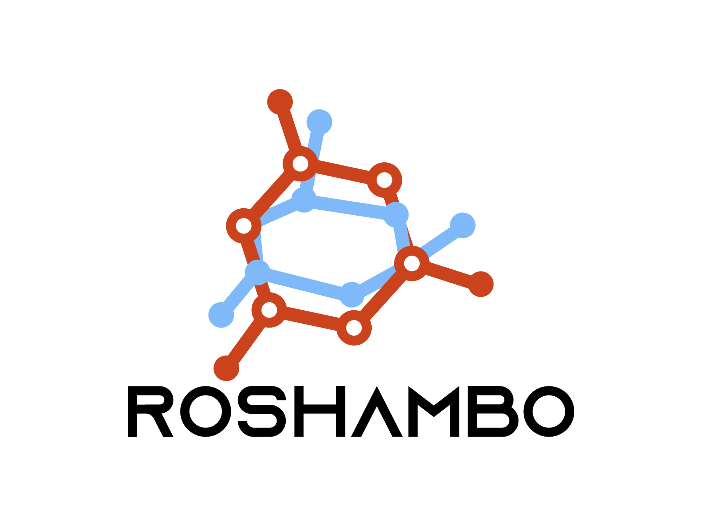

# ROSHAMBO2

<div align="left" style="padding-bottom: 1em;">

</div>

ROSHAMBO2 is a Python program for molecular shape overlay calculation. It uses the Gaussian description of molecular shape (Grant and Pickup 1995 https://doi.org/10.1021/j100011a016)

MIT License. Copyright (c) 2025

## Install

See [INSTALL.md](INSTALL.md) for full installation instructions, including
the conda and [uv](https://docs.astral.sh/uv/) paths, CMake requirements, and
how to target specific GPU architectures.

## Usage

See the examples folder: "examples/README.md"

And the user guide: "USER_GUIDE.md"

## Developers

See the developer guide: "DEV_GUIDE.md"

## Testing

Test can be run using pytest in the test folder. You will need to install `pytest` and `pytorch`.

```
cd test
pytest
```

Note that the PyTorch is used in the testing framework.
(Autograd can compute the overlap gradients which are compared with
the hand-coded ones in the ROSHAMBO2 C++ and CUDA code.)
